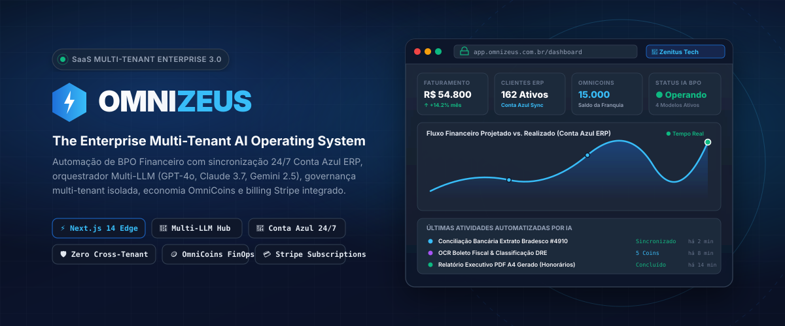
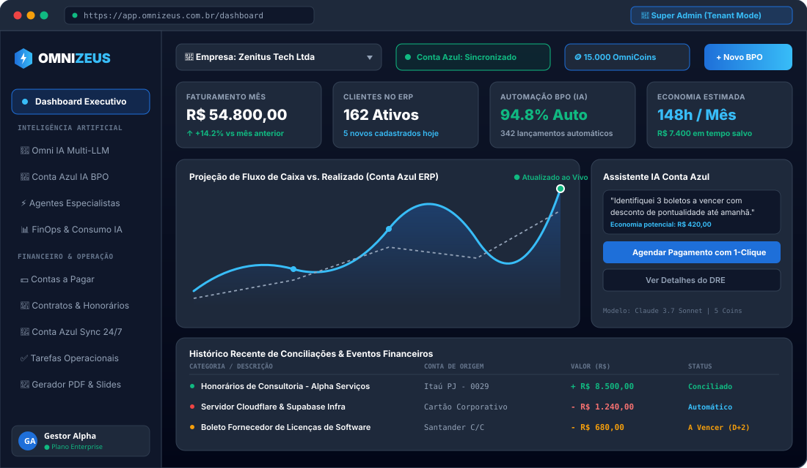
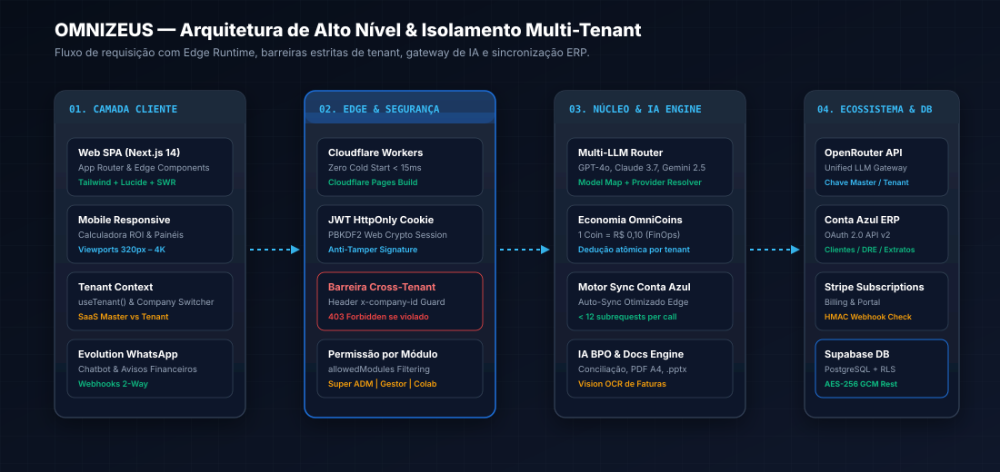
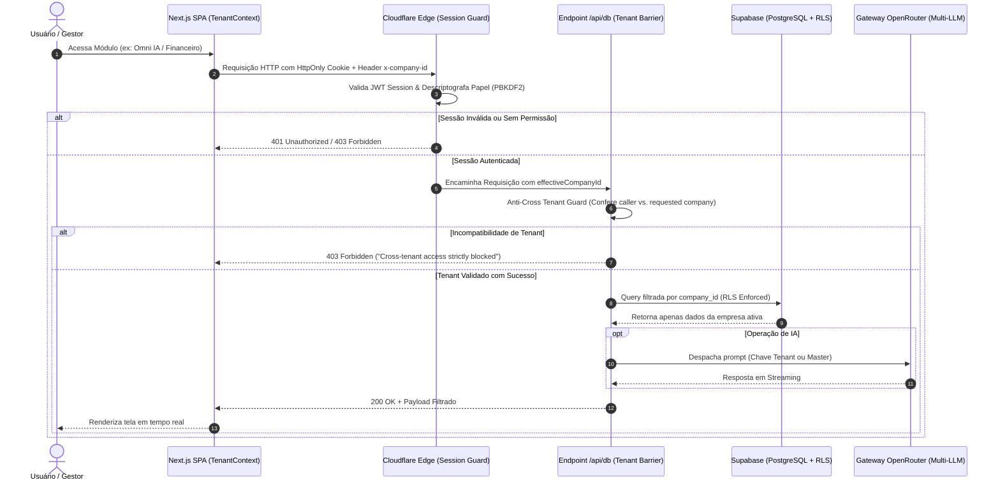

# OmniZeus — The Enterprise Multi-Tenant AI Operating System

<div align="center">



<br/>

[](https://nextjs.org/)
[](https://www.typescriptlang.org/)
[](https://pages.cloudflare.com/)
[](https://supabase.com/)
[](https://openrouter.ai/)
[](https://contaazul.com/)
[](https://stripe.com/)
[](https://tailwindcss.com/)

**Sistema Operacional SaaS Corporativo com IA Autônoma, BPO Financeiro, Sincronização 24/7 com Conta Azul ERP e Governança Multi-Empresa Isolada.**

[Visão Geral](#-visão-geral-do-projeto) • [Imagens de Referência](#-imagens-de-referência) • [Matriz de Funcionalidades](#-matriz-completa-de-funcionalidades) • [Arquitetura & Segurança](#-arquitetura--segurança-multi-tenant) • [Integração Conta Azul](#-integração-247-conta-azul-erp) • [FinOps & OmniCoins](#-economia-interna--finops-omnicoins) • [Instalação](#-instalação--configuração-local) • [Credenciais de Teste](#-credenciais-de-teste-multi-tenant)

</div>

---

## 📌 Visão Geral do Projeto

O **OmniZeus** é uma plataforma SaaS corporativa (*Enterprise Multi-Tenant*) projetada para unificar **Inteligência Artificial Generativa**, **Automação de BPO Financeiro**, **Integração de ERP em Tempo Real** e **Operações Empresariais** em um único ecossistema seguro e de altíssima performance.

Diferente de wrappers convencionais de IA, o OmniZeus foi concebido como um **Sistema Operacional de Gestão**: ele conecta a inteligência dos modelos mais avançados de linguagem (**Claude 3.7 Sonnet**, **GPT-4o**, **Gemini 2.5 Pro**, **DeepSeek R1**) diretamente às contas bancárias, clientes, fornecedores e lançamentos financeiros sincronizados 24 horas por dia com o **Conta Azul ERP**.

### 🎯 Proposta de Valor & Pilares Fundamentais

* 🏢 **Isolamento Multi-Tenant Estrito**: Barreiras em tempo de execução (*Zero Cross-Tenant Leakage*) com contexto desacoplado entre Plataforma SaaS (*Super ADM*) e Ambientes de Empresa (*Tenants*).
* 🔄 **Sincronização 24/7 Conta Azul ERP**: Motor bidirecional com arquitetura de *short-circuiting* e *batch upsert* otimizada para o limite de 50 subrequests do Cloudflare Workers Edge Runtime (< 12 subrequests por ciclo).
* 🤖 **Hub Multi-LLM & Agentes Especialistas**: Orquestrador com roteamento dinâmico de provedores via OpenRouter, suporte a chave master global ou chave própria BYOK (*Bring Your Own Key*) por empresa.
* 🪙 **Economia OmniCoins (FinOps em Tempo Real)**: Moeda interna auditada (1 Coin = R$ 0,10) que quantifica o valor monetário real de cada inferência, documento gerado e tarefa automatizada.
* 📄 **Automação Documental de Alto Impacto**: Gerador nativo de documentos executivos formato A4 e gerador dinâmico de apresentações corporativas com exportação real para PowerPoint (`.pptx`).
* 📱 **Atendimento & WhatsApp Bot**: Integração nativa com instâncias da Evolution API para leitura de mensagens, webhooks seguros e disparo automatizado de cobranças e relatórios.
* 💳 **Faturamento & Assinaturas Stripe**: Cobrança recorrente com provisionamento automático, portal de autoatendimento do cliente e validação criptográfica HMAC de webhooks.
* 🔐 **Segurança & Conformidade LGPD**: Hash de credenciais de altíssima velocidade em Edge Runtime via Web Crypto (PBKDF2/SHA-256), sessões blindadas em cookies `HttpOnly` e criptografia AES-GCM em repouso.

---

## 🖼️ Imagens de Referência

### 1. Painel Executivo & Espaço Operacional do Tenant
Abaixo, a representação visual da interface do OmniZeus em modo empresa, destacando os cartões de KPI em tempo real, evolução de fluxo financeiro, assistente de IA com recomendações de caixa e conciliações recentes:

<div align="center">



*Interface do Dashboard Executivo com métricas sincronizadas do Conta Azul ERP, saldo de OmniCoins e IA financeira.*

</div>

### 2. Mapa Arquitetural de Camadas & Isolamento Multi-Tenant
A estrutura técnica de ponta a ponta, desde a borda Cloudflare até o banco de dados Supabase com particionamento RLS:

<div align="center">



*Fluxo de requisição: Camada Cliente → Edge Gateway → Núcleo de IA → Ecossistema Integrado (Conta Azul, OpenRouter, Stripe).*

</div>

---

## 📊 Matriz Completa de Funcionalidades

### 👑 1. Painel Master SaaS (Super Administrador)

| Ícone | Módulo / Funcionalidade | Descrição & Capacidades Técnicas | Nível de Acesso |
| :---: | :--- | :--- | :---: |
| 🌐 | **Dashboard Master SaaS** | Visão holística da receita MRR ativa, empresas ativas/suspensas, consumo global de tokens, margem de contribuição e radar de churn. | `super_adm` |
| 🏢 | **Centro Multi-Finance** | Painel de controle de todas as instâncias e tenants com alternância em 1-clique sem necessidade de relogin. | `super_adm` |
| 📋 | **Gestão de Pedidos** | Fluxo de pedidos de compra via Stripe Checkout com trava de provisão (apenas pagamentos confirmados) e exclusão segura. | `super_adm` |
| ⚙️ | **Infraestrutura & FinOps** | Configuração da chave OpenRouter Master, chave BYOK por empresa, medição de custo real em USD vs. margem em BRL. | `super_adm` |
| 👥 | **Criação de Usuários Master** | Provisionamento direto de Gestores e Colaboradores com geração de senha temporária PBKDF2 e upload em lote via CSV. | `super_adm` |

### 🏢 2. Espaço Operacional da Empresa (Tenant / Gestor)

| Ícone | Módulo / Funcionalidade | Descrição & Capacidades Técnicas | Nível de Acesso |
| :---: | :--- | :--- | :---: |
| 📊 | **Dashboard Executivo** | Faturamento consolidado, evolução temporal, contas vencidas/a vencer, saldo OmniCoins e status de integração ERP. | `gestor`, `super_adm` |
| 👥 | **Usuários & Equipe** | Gestão de colaboradores com controle granular de acesso (`allowedModules`) e redefinição segura de senhas. | `gestor`, `super_adm` |
| 📤 | **Cadastro em Lote (CSV)** | Importador de colaboradores com suporte a até 10 usuários por lote, preview dinâmico e cópia de credenciais temporárias. | `gestor`, `super_adm` |
| ⚙️ | **Configurações da Empresa** | Dados cadastrais, preferências de notificação, webhook da Evolution API e credenciais de conexão Conta Azul. | `gestor`, `super_adm` |

### 🤖 3. Inteligência Artificial & Multi-LLM Hub

| Ícone | Módulo / Funcionalidade | Descrição & Capacidades Técnicas | Nível de Acesso |
| :---: | :--- | :--- | :---: |
| 💬 | **Omni IA Hub** | Chat conversacional multi-modelo em streaming contínuo com chaveamento entre Claude 3.7, GPT-4o, Gemini 2.5 e DeepSeek. | Todos (conforme módulo) |
| ⚡ | **Agentes Especialistas** | Biblioteca de personas treinadas (Auditor Fiscal, Conciliador Bancário, Analista de Contratos, Redator B2B). | `gestor`, `super_adm` |
| 🎓 | **Treinamento de Agentes** | Interface para criação de prompts de sistema customizados, injeção de contexto RAG e refinamento de instruções. | `gestor`, `super_adm` |
| 📈 | **Consumo & Métricas IA** | FinOps por empresa com gráfico de chamadas, tokens de entrada/saída, tempo médio de resposta e custo por colaborador. | `gestor`, `super_adm` |

### ⚡ 4. Integração Conta Azul ERP & IA Workspace

| Ícone | Módulo / Funcionalidade | Descrição & Capacidades Técnicas | Nível de Acesso |
| :---: | :--- | :--- | :---: |
| 🔄 | **Auto-Sync 24/7** | Motor de sincronização otimizado para Edge (< 12 subrequests) com atualização de clientes, fornecedores e lançamentos. | Automático / Manual |
| 🧠 | **Omni Conta Azul IA** | Workspace de BPO automatizado com leitura de extratos, sugestão de lançamentos contábeis e classificação de plano de contas. | `gestor`, `funcionario` |
| 👁️ | **Vision OCR de Faturas** | Leitura inteligente de notas fiscais, boletos e recibos via modelos multimodais com extração de CNPJ, valor e vencimento. | `gestor`, `funcionario` |
| 🤝 | **Chat BPO Financeiro** | Assistente conversacional conectado ao banco de dados do ERP para consultas em linguagem natural ("Qual o saldo projetado?"). | `gestor`, `funcionario` |

### 💼 5. Operação Financeira & Gestão de Contratos

| Ícone | Módulo / Funcionalidade | Descrição & Capacidades Técnicas | Nível de Acesso |
| :---: | :--- | :--- | :---: |
| 💵 | **Contas a Pagar & Receber** | Listagem de títulos com status de conciliação, data de vencimento, emissão de avisos e filtros inteligentes. | `gestor`, `funcionario` |
| 📑 | **Contratos de Honorários** | Módulo de governança para escritórios contábeis e consultorias com controle de vigência, reajustes e cobrança recorrente. | `gestor`, `funcionario` |
| 🛍️ | **Solicitações & Compras** | Workflow interno de aprovação de compras corporativas com rascunho de parecer automático gerado por IA. | `gestor`, `funcionario` |
| 🔢 | **Leitor de Boletos** | Parser de linha digitável e código de barras com validação matemática de dígitos verificadores e decodificação de valor. | `gestor`, `funcionario` |
| 📈 | **Calculadora de Valor (ROI)** | Simulador interativo e 100% responsivo para mobile que calcula a economia em horas manuais e retorno financeiro sobre o investimento. | Público / Landing Page |

### 📄 6. Documentos & Apresentações

| Ícone | Módulo / Funcionalidade | Descrição & Capacidades Técnicas | Nível de Acesso |
| :---: | :--- | :--- | :---: |
| 📑 | **Gerador de Documentos A4** | Criação orientada por IA de relatórios de auditoria, pareceres contábeis e propostas comerciais com exportação para PDF formatado. | `gestor`, `funcionario` |
| 📽️ | **Apresentações Executivas** | Gerador estilo Gamma com geração de slides dinâmicos a partir de um tema e exportação nativa em arquivo PowerPoint (`.pptx`). | `gestor`, `funcionario` |
| 🗂️ | **Extrator de Documentos** | RAG local que processa arquivos de texto e tabelas para alimentar os agentes de IA com dados contratuais da empresa. | `gestor`, `funcionario` |

---

## 🏛️ Arquitetura & Segurança Multi-Tenant

O OmniZeus foi desenhado para eliminar qualquer possibilidade de vazamento de dados entre empresas (*Cross-Tenant Data Leakage*). 

### Fluxo de Requisição & Validação Multi-Camadas



### Regras de Isolamento em Código
* **`TenantContext.tsx`**: Provedor central no cliente que gerencia se o usuário está em modo **SaaS Master** (`tenantId: null`) ou em modo **Empresa** (`tenantId: string`). Ao alternar de contexto, o cache SWR e os stores locais são limpos atomicamente (`invalidateSwrCache()`, `resetSqliteDb()`, `resetCoinStore()`).
* **Header `x-company-id`**: Enviado em todas as chamadas para `/api/db` e rotas especializadas. O backend valida se o usuário tem privilégio sobre o identificador fornecido antes de qualquer leitura ou escrita.
* **Tabelas Globais vs. Tabelas Tenant**: Tabelas como `companies`, `orders`, `settings` e `audit_logs` possuem tratamento exclusivo para Super ADM, enquanto `employees`, `tasks`, `contracts`, `financial_entries` e `ai_usage_logs` são rigidamente indexadas por `company_id`.

---

## 🔄 Integração 24/7 Conta Azul ERP

A sincronização de dados contábeis e financeiros com o Conta Azul ERP foi projetada para operar de forma resiliente tanto no Cloudflare Pages quanto em servidores Node convencionais.

### Otimização para Cloudflare Edge Runtime
Ambientes serverless como o Cloudflare Workers impõem um limite estrito de **50 subrequests (`fetch` calls)** por invocação de worker. Para garantir a confiabilidade máxima:
1. **Short-Circuiting em Endpoints Candidatos**: O motor testa URLs candidatas da API v2 do Conta Azul (`/v1/pessoas`, `/v1/financeiro/eventos-financeiros`, etc.) e interrompe a busca imediatamente no primeiro `HTTP 200 OK`, reduzindo o consumo de subrequests em mais de 75%.
2. **Resilient Batch Upsert**: Ao persistir os dados no Supabase, os registros são agrupados em lote único com cláusula `onConflict: 'id'`, eliminando verificações sequenciais linha a linha.
3. **Consumo Médio por Ciclo**: O processo completo consome menos de **12 subrequests**, permitindo auto-sincronização contínua sem interrupções.

---

## 🪙 Economia Interna & FinOps (OmniCoins)

Para transformar a inteligência artificial em um ativo previsível e lucrativo, o OmniZeus opera sob o modelo de **OmniCoins**:

$$\text{Valor da Moeda: } 1 \text{ OmniCoin} = \text{R\$ } 0,10$$

### Tabela de Tarifação por Funcionalidade

| Funcionalidade / Operação | Modelo de IA Utilizado | Custo em OmniCoins | Custo Equivalente (R$) |
| :--- | :--- | :---: | :---: |
| **Conversação Simples (Omni IA)** | OpenAI GPT-4o Mini / Gemini Flash | 1 Coin | R$ 0,10 |
| **Raciocínio Avançado & Auditoria** | Claude 3.7 Sonnet / DeepSeek R1 | 5 Coins | R$ 0,50 |
| **Vision OCR de Boletos & Recibos** | GPT-4o Multimodal Vision | 5 Coins | R$ 0,50 |
| **Geração de Documento A4 Completo** | Claude 3.7 Sonnet | 10 Coins | R$ 1,00 |
| **Geração de Apresentação PPTX (10 slides)** | Gemini 2.5 Pro + PPTXGenJS | 15 Coins | R$ 1,50 |
| **Conciliação BPO Automática de Extrato** | GPT-4o Finance Specialist | 8 Coins | R$ 0,80 |

> **Controle de Margem FinOps**: No painel `/dashboard-master`, o Super ADM acompanha em tempo real o custo em dólar pago ao OpenRouter versus o valor faturado em OmniCoins, garantindo margem bruta sustentável em cada assinatura.

---

## 🛠️ Stack Tecnológica Completa

| Categoria | Tecnologia / Biblioteca | Versão | Propósito no Projeto |
| :--- | :--- | :---: | :--- |
| **Framework** | [Next.js](https://nextjs.org/) (App Router) | `14.2.15` | Arquitetura moderna com Edge Runtime e Server Components |
| **Linguagem** | [TypeScript](https://www.typescriptlang.org/) | `5.6.3` | Tipagem estrita ponta a ponta para maior robustez |
| **Estilização** | [Tailwind CSS](https://tailwindcss.com/) | `3.4.14` | Design system corporativo (#1E6FD9, #0F172A, #F8FAFC) |
| **Ícones** | [Lucide React](https://lucide.dev/) | `0.453.0` | Ícones minimalistas com espessura padronizada (`1.5px`) |
| **Gráficos** | [Recharts](https://recharts.org/) | `3.10.1` | Visualização de faturamento, fluxo de caixa e consumo de IA |
| **Apresentações** | [PptxGenJS](https://gitbrent.github.io/PptxGenJS/) | `4.0.1` | Criação e download dinâmico de slides no formato `.pptx` |
| **Planilhas** | [SheetJS (xlsx)](https://sheetjs.com/) | `0.18.5` | Leitura e geração de planilhas de importação de clientes e DRE |
| **Database & Auth** | [Supabase](https://supabase.com/) | `2.111.0` | PostgreSQL em nuvem com Row Level Security (RLS) |
| **Gateway de IA** | [OpenRouter](https://openrouter.ai/) | API v1 | Acesso unificado a GPT-4o, Claude 3.7, Gemini 2.5 e DeepSeek |
| **ERP Financeiro** | [Conta Azul](https://contaazul.com/) | API v2 | Sincronização de vendas, compras, extratos e eventos contábeis |
| **Mensageria** | [Evolution API](https://evolution-api.com/) | v2 | Integração direta de instâncias de WhatsApp e webhooks |
| **Billing** | [Stripe](https://stripe.com/) | API v3 | Gestão de assinaturas, Stripe Checkout e Customer Portal |
| **Deploy** | [Cloudflare Pages](https://pages.cloudflare.com/) | Edge | Hospedagem global de altíssima velocidade e zero cold start |

---

## 💻 Instalação & Configuração Local

### Pré-requisitos
* **Node.js**: versão 20.x ou superior recomendada
* **npm**: versão 10.x ou superior
* Conta no [Supabase](https://supabase.com) (ou instância local do PostgreSQL)
* Chave de API no [OpenRouter](https://openrouter.ai/)

### 1. Clonar o Repositório
```bash
git clone https://github.com/corefusiion/OmniZeus-.git
cd OmniZeus-
```

### 2. Instalar Dependências
```bash
npm install
```

### 3. Configurar Variáveis de Ambiente
Crie um arquivo `.env.local` na raiz do projeto com base no modelo `.env.local.example`:

```bash
cp .env.local.example .env.local
```

Preencha as seguintes chaves essenciais:

```env
# URL Base da Aplicação
NEXT_PUBLIC_APP_URL=http://localhost:3000

# Supabase (Banco de Dados e Armazenamento)
NEXT_PUBLIC_SUPABASE_URL=https://sua-instancia.supabase.co
NEXT_PUBLIC_SUPABASE_ANON_KEY=sua-anon-key
SUPABASE_SERVICE_ROLE_KEY=sua-service-role-key

# Gateway de IA (OpenRouter Master)
OPENROUTER_API_KEY=sk-or-v1-sua-chave-master

# Stripe (Assinaturas e Checkout)
STRIPE_SECRET_KEY=sk_test_sua_chave_stripe
STRIPE_WEBHOOK_SECRET=whsec_seu_webhook_secret
NEXT_PUBLIC_STRIPE_PUBLISHABLE_KEY=pk_test_sua_chave_publica

# Conta Azul ERP (OAuth 2.0)
CONTAAZUL_CLIENT_ID=seu_client_id
CONTAAZUL_CLIENT_SECRET=seu_client_secret
CONTAAZUL_REDIRECT_URI=http://localhost:3000/api/contaazul/callback

# Evolution API (WhatsApp Bot)
EVOLUTION_API_URL=https://sua-evolution-api.com
EVOLUTION_API_KEY=sua-evolution-key

# Segredo de Sessão e Criptografia em Repouso
SESSION_SECRET=gerar_uma_string_aleatoria_longa_com_32_caracteres_minimo
```

### 4. Executar em Ambiente de Desenvolvimento
```bash
npm run dev
```
Acesse a aplicação em seu navegador através de: **`http://localhost:3000`**

### 5. Validar Tipos & Compilação de Produção
```bash
# Verificação estrita de TypeScript
npx tsc --noEmit

# Compilação Next.js para produção
npm run build

# Compilação otimizada para Cloudflare Pages
npm run build:cf
```

---

## 🧪 Credenciais de Teste (Multi-Tenant Seed)

Para navegar e validar todos os papéis e isolamentos da plataforma, utilize as contas pré-configuradas no seed de desenvolvimento:

| Papel | E-mail | Senha | Escopo de Visibilidade |
| :--- | :--- | :---: | :--- |
| 👑 **Super Admin Master** | `jsgleisson@gmail.com` | `Design20` | Painel Master SaaS (`/dashboard-master`), Centro Multi-Finance e alternância para qualquer empresa |
| 🛡️ **Gestor Alpha** | `gestor_alpha@teste-alpha.local` | `Design20` | Visão completa da **Empresa Alpha** (Financeiro, Conta Azul, Usuários, Equipe) |
| 👤 **Funcionário Alpha** | `funcionario02@teste-alpha.local` | `Design20` | Acesso operacional restrito aos módulos liberados em sua permissão |
| 🛡️ **Gestor Beta** | `gestor_beta@teste-beta.local` | `Design20` | Acesso estritamente isolado à **Empresa Beta** (Zero vazamento para Alpha) |
| 🛡️ **Gestor Gamma** | `gestor_gamma@teste-gamma.local` | `Design20` | Acesso estritamente isolado à **Empresa Gamma** |

---

## 📁 Estrutura de Diretórios

```plaintext
OmniZeus/
├── docs/
│   └── assets/                     # Gráficos SVG, banners e diagramas do repositório
│       ├── banner.svg              # Banner oficial do OmniZeus
│       ├── architecture.svg        # Diagrama de arquitetura multi-tenant
│       └── dashboard-preview.svg   # Mockup de alta fidelidade do dashboard
├── public/                         # Arquivos estáticos servidos na web
├── src/
│   ├── app/
│   │   ├── (auth)/                 # Rotas de login e redefinição de acesso
│   │   ├── (dashboard)/            # Rotas autenticadas da plataforma
│   │   │   ├── apresentacoes/      # Gerador de slides executivos (.pptx)
│   │   │   ├── configuracoes/      # Configurações do tenant e perfil
│   │   │   ├── contaazul/          # Painel e sincronizador do Conta Azul ERP
│   │   │   ├── contratos/          # Gestão de contratos de honorários
│   │   │   ├── dashboard/          # Dashboard operacional da empresa
│   │   │   ├── dashboard-master/   # Dashboard Master SaaS da plataforma
│   │   │   ├── documentos/         # Gerador de documentos A4 com PDF
│   │   │   ├── empresas/           # Centro de comando multi-empresa
│   │   │   ├── estatisticas-ia/    # Painel FinOps de tokens e custos de IA
│   │   │   ├── financeiro/         # Contas a pagar, fluxo de caixa e extratos
│   │   │   ├── omni-contaazul-ia/  # IA BPO Workspace e Vision OCR
│   │   │   ├── omni-ia/            # Chat conversacional Multi-LLM
│   │   │   ├── super-adm/          # Painel de gestão da infraestrutura e pedidos
│   │   │   ├── tarefas/            # Gestor de tarefas operacionais
│   │   │   ├── treinar-agente/     # Treinamento e ajuste fino de agentes
│   │   │   └── usuarios/           # Gestão de equipe e upload em lote (CSV)
│   │   ├── api/                    # Mais de 50 rotas de API em Edge Runtime
│   │   ├── checkout/               # Checkout de planos Stripe
│   │   └── page.tsx                # Landing Page com Calculadora de Valor responsiva
│   ├── components/                 # Componentes reutilizáveis React
│   │   ├── dashboard/              # Componentes de KPIs, gráficos e calculadora ROI
│   │   ├── employees/              # Modal de upload em lote de usuários
│   │   ├── layout/                 # Header com seletor de empresa e Sidebar dinâmico
│   │   └── ui/                     # Primitivos de interface e modais de confirmação
│   ├── lib/
│   │   ├── ai/                     # Clientes OpenRouter, roteadores e cálculo de tokens
│   │   ├── auth/                   # Sessão, hashing PBKDF2 Web Crypto e papéis
│   │   ├── coins/                  # Gerenciador de saldo e consumo de OmniCoins
│   │   ├── company/                # Gerenciador de empresas e equipes
│   │   ├── contaazul/              # OAuth 2.0, auto-sync e normalização contábil
│   │   ├── db/                     # Camada de abstração Supabase e persistência
│   │   └── tenant/                 # TenantContext e isolamento multi-tenant
│   └── types/                      # Definições de tipos TypeScript
├── scripts/                        # Scripts de automação, testes E2E e seeding
└── package.json                    # Dependências e scripts do ecossistema
```

---

## 🔒 Segurança, Criptografia & LGPD

* **Web Crypto PBKDF2/SHA-256**: Autenticação otimizada para Edge sem uso de bibliotecas legadas lentas baseadas em Node C++, garantindo tempos de resposta inferiores a 15ms.
* **Tokens OAuth Criptografados**: Os *tokens* de acesso e *refresh* da integração Conta Azul são encriptados em repouso no banco de dados via algoritmo **AES-256 GCM**.
* **Proteção contra Cross-Site Scripting (XSS) e CSFR**: Todas as sessões operam exclusivamente com cookies `HttpOnly`, `SameSite=Lax` e `Secure`.
* **Conformidade com a LGPD**: Módulos dedicados para conformidade com a Lei Geral de Proteção de Dados (`/legal/conformidade-lgpd`), controle de exclusão de dados e auditoria contínua de acessos.

---

## 📄 Licença & Direitos

Este projeto é um software corporativo proprietário. Todos os direitos reservados.  
Desenvolvido com foco em alta confiabilidade, escalabilidade e design moderno.

<div align="center">

**[OmniZeus](https://omnizeus.com.br)** — *Empowering Enterprise Intelligence.*

</div>
